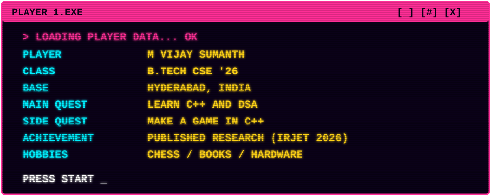

  

  

## `> ABOUT.TXT`

I like building things where I can see the whole machine, from the button on the screen to the database underneath to the part where it breaks at 2am.

Fresh CS grad from Hyderabad. Right now I'm drilling C++ and DSA, shipping small projects, and reading about what actually happens between my code and the CPU.

I also co-wrote a paper on **BharatCare**, a healthcare assistant for people who can't easily get good medical info in their own language. It was published in IRJET in March 2026.

## `> INVENTORY`

  

## `> LEVEL SELECT`

**STAGE 1-1: [secure-password-manager](https://github.com/VijayUchiha2004/secure-password-manager)**
Node, Express and MySQL. JWT logins, bcrypt for passwords, AES-256-GCM for the vault. The project where security stopped being a buzzword for me.

**STAGE 1-2: [crop-disease-detection](https://github.com/VijayUchiha2004/crop-disease-detection)**
A CNN that looks at a pepper, potato or tomato leaf and says what's wrong with it. Wrapped in a Streamlit app so nobody needs to know what a CNN is.

**STAGE 2-1: BharatCare**
Disease prediction, local environmental risk and AI explanations, in multiple languages. Published in IRJET.

**STAGE 3-1: [AI-Finance-Tracker](https://github.com/VijayUchiha2004/AI-Finance-Tracker) / [AI-Finance-Manager](https://github.com/VijayUchiha2004/AI-Finance-Manager)**
Experiments with putting LLMs on top of boring money data.

**BONUS STAGE: ???**
Next: a game in C++.

## `> HIGH SCORES`

  
  

## `> CONTINUE?`

[email](mailto:mvijaysumanth@gmail.com) / [linkedin](https://www.linkedin.com/in/mvijay-sumanth/)

insert coin to continue
